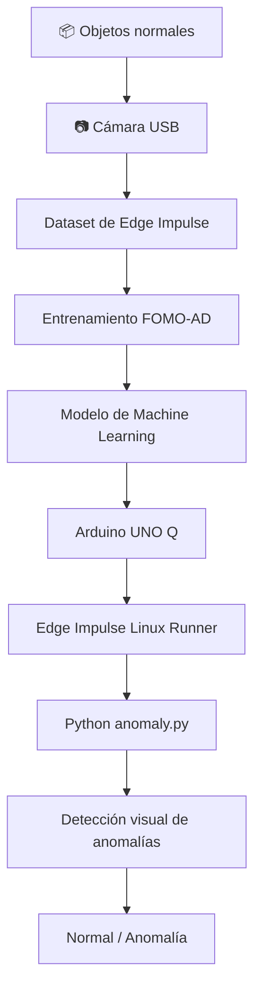

# 🔍 Detección Visual de Anomalías con Edge Machine Learning, Nerdearla MX 2026

Proyecto demo de la charla Deteccion de anomalías con Edge Machine Learning 19/11/2026, ExpoReforma CDMX

---

## 📸 Descripción del proyecto

La detección visual de anomalías tiene aplicaciones en control de calidad industrial, manufactura, mantenimiento predictivo e inspección automatizada.

A diferencia de los sistemas tradicionales de clasificación de objetos, la detección de anomalías no necesita una clase de entrenamiento diferente para cada posible defecto. En cambio, el modelo aprende las características de muestras normales e identifica desviaciones visuales.

**Hardware:**
- Arduino UNO Q (se recomienda la versión de 4 GB)
- Cámara web USB
- Hub USB
- Monitor HDMI
- Teclado
- Conexión Wi-Fi

**Software:**
- Debian Linux (pre-instalado en UNO Q)
- Python 3
- Node.js
- Edge Impulse Linux SDK
- Edge Impulse Linux Runner
- FOMO-AD (Faster Objects, More Objects – Anomaly Detection)

## 🧠 Cómo funciona

El flujo de trabajo consta de tres etapas principales:

1. **Entrenamiento:** se capturan imágenes de objetos normales y se cargan en Edge Impulse.
2. **Inferencia:** se despliega el modelo de detección de anomalías en Arduino UNO Q.
3. **Detección:** se capturan imágenes con la cámara USB y se evalúan para identificar patrones visuales inesperados.

### Arquitectura


## 🧪 1. Entrenamiento del modelo de Machine Learning

Crear una cuenta en [Edge Impulse](https://www.edgeimpulse.com/).

### Preparación del dataset

1. Capturar múltiples imágenes de objetos sin anomalías.
2. Cargar las imágenes en el proyecto de Edge Impulse.
3. Asignarles la etiqueta `no anomaly`.
4. Mantener consistentes los objetos y el fondo durante la adquisición de datos.
5. Configurar el bloque de aprendizaje utilizando FOMO-AD.
6. Entrenar y evaluar el modelo.

**Importante:** la posición, orientación, distancia e iluminación deberían mantenerse lo más constantes posible entre el entrenamiento y la inferencia. Las variaciones en estas condiciones pueden generar falsos positivos.

Asimismo se puede clonar el siguiente proyecto

**[Abrir el proyecto de detección visual de anomalías – Edge Impulse](https://studio.edgeimpulse.com/public/374008/live)**

## 🛠️ 2. Configuración del hardware

Conectar la cámara web USB y el teclado al hub USB.

Conectar el hub al Arduino UNO Q y conectar un monitor mediante HDMI.

Encender la placa y conectarla a una red Wi-Fi.

Abrir una terminal utilizando:

`CTRL + ALT + T`

## 💻 3. Instalación de dependencias

Actualizar el sistema:

```bash
sudo apt update
sudo apt install -y curl
```

Instalar Node.js 20:

```bash
curl -sL https://deb.nodesource.com/setup_20.x | sudo bash -
```

Instalar los paquetes necesarios:

```bash
sudo apt install -y gcc g++ make build-essential nodejs sox \
gstreamer1.0-tools gstreamer1.0-plugins-good \
gstreamer1.0-plugins-base gstreamer1.0-plugins-base-apps
```

Instalar Edge Impulse Linux:

```bash
sudo npm install edge-impulse-linux -g --unsafe-perm
```

## 🚀 4. Despliegue del modelo

Iniciar Edge Impulse Linux Runner:

```bash
edge-impulse-linux-runner
```

Seguir las instrucciones de autenticación y seleccionar el proyecto entrenado.

El Runner descargará el modelo correspondiente y lo preparará para realizar inferencias localmente.

Salir del Runner utilizando:

`CTRL + C`

Copiar el archivo `anomaly.py` al Arduino UNO Q.

Se puede utilizar:
- FTP
- SSH, copiando y pegando desde la terminal utilizando Nano

## ▶️ 5. Ejecutar la detección de anomalías

Abrir anomaly.py y editar

CONFIDENCE_THRESHOLD = 8.0 // limite de confianza para la detección

WEBHOOK_URL = "" // URL opcional para llamar a un endpoint (notificaciones, automatizaciones, etc)


Ejecutar el script de Python:

```bash
python3 anomaly.py
```

La aplicación utiliza Edge Impulse Linux Runner para realizar inferencias sobre las imágenes capturadas por la cámara USB.

El objetivo es identificar desviaciones visuales respecto de las muestras normales utilizadas durante el entrenamiento.

---

## ⚠️ Limitaciones de la detección visual de anomalías

La detección visual de anomalías es una herramienta potente, pero su rendimiento depende en gran medida de la adquisición de datos y de las condiciones ambientales.

| Limitación | Descripción |
|---|---|
| Fondo e iluminación | Los cambios de iluminación o de las condiciones de la superficie pueden generar falsos positivos. |
| Posición y orientación | Los objetos presentados en orientaciones no vistas durante el entrenamiento pueden recibir puntuaciones de anomalía elevadas. |
| Posición de la cámara | Los cambios en la distancia, el ángulo o el enfoque pueden afectar la inferencia. |

Para aplicaciones industriales confiables, los entornos de entrenamiento e inferencia deberían ser lo más similares posible.

---

## 🔬 Más proyectos de Machine Learning y detección de anomalías

Otros proyectos experimentales de **Roni Bandini**, que exploran Edge AI, TinyML, visión artificial, mantenimiento predictivo y detección de anomalías.

| Proyecto | Descripción |
|---|---|
| [RUBIK Pi 3 Anomaly Detection](https://github.com/ronibandini/rubikpi3-anomaly-detection) | Detección visual de anomalías con Edge Impulse, RUBIK Pi 3 y automatización mediante n8n. |
| [Visual Anomaly Detection](https://github.com/ronibandini/visualAnomaly) | Implementación de FOMO-AD utilizando Texas Instruments TDA4VM. |
| [AI Asset Protection](https://github.com/ronibandini/AI-Asset-Protection) | Protección de activos mediante IA multimodal, combinando sensores, visión artificial y agentes de IA. |
| [BTFall](https://github.com/ronibandini/BTFall) | Detección de caídas de trabajadores utilizando TinyML, Arduino Nano 33 BLE Sense y Bluetooth. |
| [Multilayer AI Agent Drone Detection](https://github.com/ronibandini/Multilayer-AI-Agent-Drone-Detection) | Detección de drones utilizando Machine Learning, Edge Impulse, OpenClaw y RUBIK Pi 3. |

### Tecnologías

`Edge Impulse` · `TinyML` · `FOMO-AD` · `Computer Vision` · `Arduino` · `Raspberry Pi` · `RUBIK Pi` · `Python` · `n8n`

---

## 🎤 Charlas y presentaciones

Algunas presentaciones y charlas técnicas relacionadas:

- **[Edge Machine Learning on Small Devices with Debian – DebConf 26](https://debconf26.debconf.org/talks/)**  
  Edge Machine Learning, Linux embebido e implementación de modelos de Machine Learning en dispositivos compactos.

- **[Dispositivos Maker para detectar drones (y reaccionar) – Nerdearla Argentina 2026](https://nerdearla.com/argentina/schedule/dispositivos-maker-para-detectar-drones-y-reaccionar/)**  
  Análisis de radiofrecuencia, Machine Learning, visión artificial y detección multicapa de drones.

---

## 👨‍💻 Sobre el autor

**Roni Bandini** es maker, programador, escritor y fundador de [Contracultura Maker](https://bandini.medium.com/).

Su trabajo explora la intersección entre Machine Learning, computación física, robótica, música electrónica y contracultura tecnológica.

Miembro del programa Qualcomm / Edge Impulse Expert Network.

### Contacto y redes sociales

| Plataforma | Enlace |
|---|---|
| GitHub | [github.com/ronibandini](https://github.com/ronibandini) |
| X / Twitter | [@RoniBandini](https://x.com/RoniBandini) |
| Instagram | [@ronibandini](https://www.instagram.com/ronibandini/) |
| TikTok | [@ronibandini](https://www.tiktok.com/@ronibandini) |
| YouTube | [Roni Bandini](https://www.youtube.com/@RoniBandini) |
| LinkedIn | [Roni Bandini](https://www.linkedin.com/in/ronibandini/) |
| Medium | [bandini.medium.com](https://bandini.medium.com/) |

---

## 🙏 Agradecimientos

- [Edge Impulse](https://www.edgeimpulse.com/)
- [Arduino](https://www.arduino.cc/)
- [Qualcomm](https://www.qualcomm.com/)

**Desarrollado por Roni Bandini — Contracultura Maker**

[GitHub](https://github.com/ronibandini) · [Medium](https://bandini.medium.com/) · [X](https://x.com/RoniBandini)
